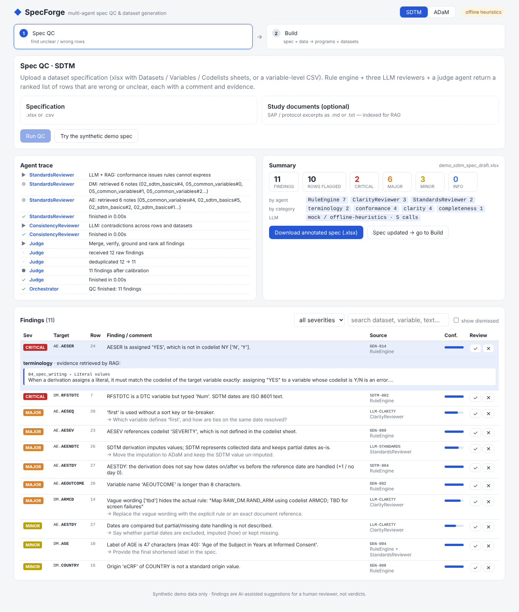
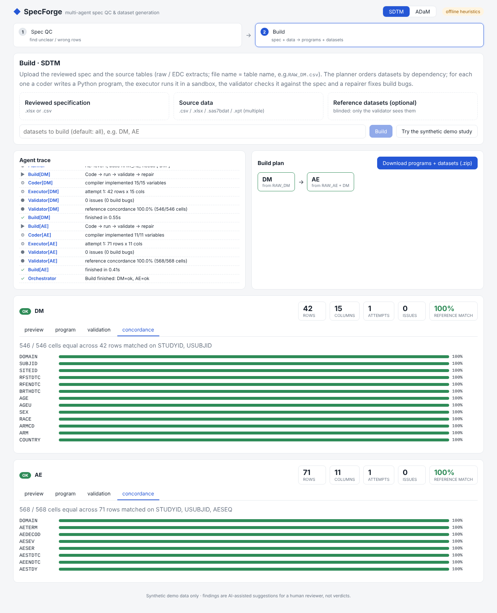
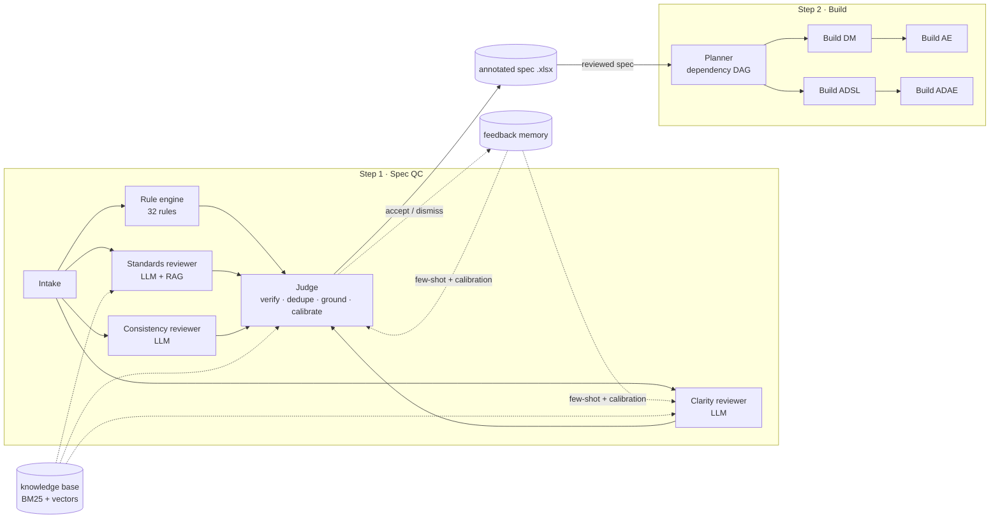

# SpecForge

[](https://github.com/Yilinhe2021/cdisc-spec-agent/actions/workflows/ci.yml)
[](LICENSE)

English | [Chinese version](docs/README.zh-CN.md)

**Multi-agent + RAG assistant for clinical dataset specifications (CDISC SDTM / ADaM).**

Two-step workflow, one web app:

1. **Spec QC** — upload a dataset spec, get back a ranked list of rows that are *wrong or unclear*, each with a
   comment, a suggested question for the spec owner, and evidence retrieved from a knowledge base. Download the
   spec with the comments written next to each row.
2. **Build** — upload the reviewed spec plus source data. Agents plan the dataset dependency graph, write a
   Python program per dataset, run it in a sandbox, validate the output against the spec (and, optionally, against
   an independently produced reference dataset, blinded), and repair build bugs automatically.

SDTM and ADaM go through the same machinery: both are "a spec that maps source tables to target tables". The
standard only switches the rule pack and the retrieved knowledge.

| Spec QC | Build |
|---|---|
|  |  |

> **Prototype.** All data in this repo is synthetic (fictional study `SYN-001`, generated by
> `examples/make_examples.py`). The knowledge base is an original plain-language summary of public conventions,
> not a copy of any CDISC document. Findings are suggestions for a human reviewer, and the tool is not validated
> for regulatory use.

## Background

I work as a clinical statistical programmer. In my previous role I led a pilot that used an LLM agent as the
"second programmer" in blinded double programming of SDTM and ADaM datasets, and a separate project that QC'd ADaM
specs line by line. A few things I learned there shaped this project:

- **Most differences came from the spec, not from the logic.** In the first pilot, 93% of the mismatched cells were
  spec text that had been re-typed (case, spacing, underscores). One mandatory step, "copy from the spec, never
  retype", brought first-pass agreement from about 98% to over 99%. Here the compiler copies literals verbatim.
- **Missing values behave differently in SAS and Python.** A group of subjects that I first blamed on the reference
  data turned out to be a `missing ne 'X'` comparison, which is true in SAS. That case now has a clarity check and a
  knowledge note.
- **One partial date can break three datasets.** An incomplete date left a subject-level date empty, and every
  dataset that merged it disagreed. Imputation rules have to be in the spec, so the compiler supports them explicitly.
- **The spec itself can be malformed.** A literal opened with `'` and closed with `"` silently dropped records.
  This is rule GEN-016.
- **Extracts are messy.** Some files were Windows-1252 while the rest were UTF-8, and some headers declared the
  wrong encoding. The build now detects encoding per file.

SpecForge rebuilds these ideas from scratch, as a public project: review the spec as if an independent programmer
had to implement it without asking anyone, then build the datasets and measure them blind against a reference. All
rules and notes are written generically. No employer code, specs or data are used, and all demo data is synthetic.

## How this was built

Built with AI-assisted development (Claude Code). I defined the architecture, the QC rule taxonomy, the blinded
validation and evaluation method, and the domain rules and traps. I reviewed and changed the generated code,
starting from the initial prototype commit. The git history shows what changed after that commit and why.

---

## Why it is built this way

| Problem | Design decision |
|---|---|
| LLMs are inconsistent on things that have exact answers (name length, types, codelists) | **Deterministic rule engine first** (32 rules). LLM agents only judge what rules can't: clarity, intent, cross-row meaning |
| A single "review everything" prompt is shallow | **Specialised reviewers** run in parallel, each with one question, its own retrieved context and a strict JSON schema: *Clarity* (could an independent programmer implement this without asking?), *Standards* (RAG-grounded conformance), *Consistency* (contradictions across rows/datasets) |
| Hallucinated or duplicate findings | **Judge agent**: LLM self-verification of LLM findings, drops findings that point at variables that don't exist, de-duplicates across agents (agreement raises confidence), attaches RAG evidence |
| Every team has a different review taste | **Feedback memory**: accept/dismiss in the UI is stored, retrieved as few-shot calibration examples, and used by the Judge to down-weight patterns humans keep dismissing |
| CDISC questions mix exact identifiers and fuzzy concepts | **Hybrid retrieval**: BM25 + dense vectors fused with Reciprocal Rank Fusion; concrete names expand to generic form (`AESTDTC` → `--STDTC`) |
| LLM-generated code drifts and re-types spec text (case, spacing, punctuation) | **Compiler first, LLM for the long tail**: a deterministic compiler turns derivations written in a controlled vocabulary into exact code, copying literals from the spec verbatim. Only rows it can't parse become `TODO` stubs for the LLM Coder |
| Generated programs re-implement the same helpers slightly differently | Shared, unit-tested **runtime library** (ISO dates, study day without day 0, age, sequence numbers, strict codelist mapping, safe merges) |
| "Fixing" an ambiguous spec by guessing | The validator classifies every issue as `BUILD_BUG` (repair loop fixes it), `SPEC_GAP` (reported, never guessed) or `DATA_ISSUE` |
| Independent double programming | Reference datasets are passed **only to the Validator**. The Coder never sees them; concordance is cell-by-cell with key matching and Unicode/NBSP/numeric normalisation |
| Silent coverage gaps | Each agent reports what it did *not* check (e.g. "no codelist sheet → terminology checks skipped") |

## Architecture



Each `Build[...]` node runs: **Coder** (compiler draft → LLM fills TODO rows) → **Executor** (sandboxed subprocess,
CPU/memory/time limits) → **Validator** (spec conformance + blinded reference concordance) → **Repairer** (LLM patch
on `BUILD_BUG`, up to N attempts). Independent datasets build in parallel.

All agents emit structured trace events, streamed to the browser over Server-Sent Events.

```
backend/specforge/
  models.py            shared pydantic models (Spec, Finding, TraceEvent, ...)
  orchestration.py     tiny async agent-graph runtime (DAG, parallel nodes, tracing)
  spec/parser.py       alias-based reader for real-world spec workbooks
  llm/                 provider interface: Anthropic | OpenAI | offline mock
  rag/                 hybrid retriever, knowledge base (markdown), feedback memory
  qc/                  rules/, agents.py, pipeline.py, annotate.py (xlsx write-back)
  build/               compiler.py, agents.py, sandbox.py, validate.py, pipeline.py
  runtime/stdlib.py    helper library imported by generated programs
  api/app.py           FastAPI: jobs, SSE trace, downloads, demo endpoints
  mcp_server.py        MCP server (review_spec, build_datasets, search_knowledge, list_rules)
  cli.py               `specforge qc|build|serve`
frontend/              React + Vite + TypeScript (two pages)
eval/run_eval.py       seeded-defect recall, mutation testing, false positives, build concordance
examples/              synthetic study generator + generated specs/data/references
```

## Quick start

```bash
git clone https://github.com/Yilinhe2021/cdisc-spec-agent.git && cd cdisc-spec-agent

# backend (Python 3.10+)
pip install -e "backend[anthropic,openai,dev]"
python examples/make_examples.py          # synthetic demo study
cp .env.example .env                      # add ANTHROPIC_API_KEY (or leave empty for offline mode)

# frontend
cd frontend && npm install && npm run build && cd ..

uvicorn specforge.api.app:app --app-dir backend --port 8000
# open http://localhost:8000 → "Try the synthetic demo spec"
```

On macOS you can also double-click `start.command`.

or `docker compose up --build` (the Dockerfile is provided but not yet tested in CI).

Without an API key the app runs in **offline mode**: every LLM agent falls back to a documented heuristic
(`@register_mock` next to each prompt), so the whole pipeline, UI, tests and eval run with zero credentials.

CLI:

```bash
specforge qc examples/adam/spec_draft.xlsx --standard ADaM
specforge build examples/sdtm/spec_final.xlsx --standard SDTM \
  --data examples/sdtm/raw/*.csv --reference examples/sdtm/reference/*.csv
```

MCP (use the tools from Claude Desktop / Claude Code / any MCP client):

```bash
pip install -e "backend[mcp]" && python -m specforge.mcp_server
```

## Evaluation

`python eval/run_eval.py --llm mock` (results in [`eval/RESULTS.md`](eval/RESULTS.md)):

| Metric | Offline mode |
|---|---|
| Seeded defects found (23 hand-written defects in the two draft specs) | 23 / 23 |
| Findings on the clean specs (false positives) | 0 |
| Mutation testing: 60 random single-defect mutants, 10 operators | 60 / 60 |
| Build: cell-level concordance vs independently hand-coded reference (DM, AE, ADSL, ADAE) | 100% (2,596 cells) |

Read these numbers with care: the demo specs and mutation operators were written alongside the rules, so offline
recall is an upper bound on a friendly benchmark. The harness exists so you can rerun it with
`--llm anthropic`, add operators, and see regressions in CI.

## Spec format

An `.xlsx` with sheets for **Datasets** (name, label, structure, keys, sources), **Variables** (dataset, variable,
label, type, length, origin, source/derivation, codelist, core) and **Codelists** (codelist, code, decode). Column
and sheet names are matched by alias, so most templates work; a single variable-level CSV also works.

The offline compiler understands this derivation vocabulary (anything else goes to the LLM Coder):

```
DS.VAR [merged by KEY]              Set to 'X'                  Concatenate A, '-', B
ISO 8601 date of REF                Numeric date of REF         Age in completed years from REF to REF
Study day of REF relative to REF    Sequence number within A ordered by B, C
Map REF using codelist CL[; if missing set to 'X']             Set to VAL if COND, else VAL
Numeric date of REF imputing missing day as first|last day of month [and missing month as January|December]
Imputation flag of REF              First non-missing of A, B   Upper case of REF     Earliest|Latest of A, B
<any phrase>; missing if A [or B] is missing
```

## Configuration

| Variable | Default | |
|---|---|---|
| `SPECFORGE_LLM` | auto (`anthropic` if key set, else `mock`) | `anthropic`, `openai`, `mock` |
| `SPECFORGE_MODEL` | provider default | model id |
| `SPECFORGE_SHARE_SAMPLES` | `1` | `0` = never send data values to the LLM, only column names/types |
| `SPECFORGE_MAX_REPAIRS` | `3` | build/repair attempts per dataset |
| `SPECFORGE_EMBEDDINGS` | hashing | `st` = sentence-transformers |
| `SPECFORGE_DATA_DIR` | `./.specforge` | jobs and feedback memory |
| `SPECFORGE_PUBLIC_DEMO` | `0` | `1` = offline provider, demo buttons only, uploads rejected (for public hosting) |

## Known limitations

- **Real-LLM mode is not yet evaluated.** All numbers above are from offline mode. The LLM paths (reviewers,
  Coder, Repairer, Judge verification) are implemented, but their recall/precision has not been measured yet.
- **The benchmark is friendly.** The demo specs, seeded defects and mutation operators were written alongside the
  rules. Results on independently written specs will be lower.
- **The sandbox is not a security boundary.** Generated code runs in a resource-limited subprocess. Use Docker
  for isolation, and use `SPECFORGE_PUBLIC_DEMO=1` for any public instance.
- **Jobs live in memory.** Restarting the server loses running jobs (results on disk remain). Single process only.
- **The offline compiler only knows a fixed vocabulary.** Free-text derivations need an LLM, or they are reported
  as `SPEC_GAP`.
- **Not covered yet:** SUPPQUAL, define.xml and XPT output.

## Roadmap

- [ ] SUPPQUAL generation and define.xml-style metadata output
- [ ] XPT (SAS transport) output
- [ ] CDISC Library API integration (user-supplied key) for controlled terminology and IG metadata
- [ ] Open-source conformance engine integration for output datasets
- [ ] Persistent job store (Postgres) and pgvector-backed knowledge base
- [ ] LLM-mode eval on a larger, independently written spec set

## License

MIT. Independent personal project; contains no proprietary or employer material and no real patient data.
